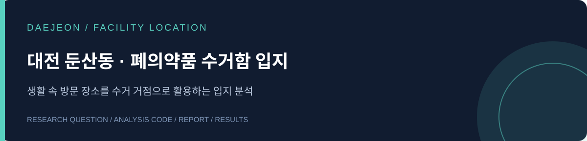

# 편의점 기반 폐의약품 수거함 입지 분석

주민이 자주 방문하는 편의점을 폐의약품 수거 장소로 활용한다면, 어디에 설치해야 더 많은 수요를 담당할 수 있을까? 대전광역시 서구 둔산동을 대상으로 수요지를 구성하고, 편의점 후보의 입지를 비교한 프로젝트입니다.

**[보고서 읽기](reports/daejeon_report.pdf) · [사용한 코드](code/) · [결과표](results/scenario_summary.csv) · [데이터 준비](docs/DATA.md)**

## 분석 흐름

공간 자료 전처리 → 인구와 주변 시설 연결 → 군집화·스코어링 → 수요지 구성 → 최대 커버링 입지 선정 → 거리·설치 수별 비교

| 내용 | 구성 |
|---|---|
| 대상 | 대전광역시 서구 둔산동 |
| 분석 관점 | 편의점을 수거함 후보로 가정한 수요 커버 |
| 방법 | 공간 분석, 군집화, 가중 수요, 최대 커버링 모형(PuLP) |
| 비교 조건 | 직선거리 200~400m, 시설 6~18곳 |

## 저장된 결과

350m 조건에서 시설 6곳의 커버율은 86.28%, 10곳은 95.96%, 12곳은 96.75%입니다. 이 값은 원 분석에서 구성한 **가중 수요의 커버율**이며, 실제 폐의약품 수거율을 뜻하지 않습니다. 기존 수거함 분석은 별도 노트북에 있습니다.

## 코드와 보고서

| 폴더 | 내용 |
|---|---|
| `code/` | 당시 사용한 여섯 개 분석 노트북과 필요 패키지 |
| `reports/` | 원본 분석보고서 PDF |
| `results/` | 저장된 거리·시설 수별 결과표 |
| `docs/` | 실행 순서와 데이터 안내 |

노트북의 분석 내용은 보존하고 저장된 출력만 비웠습니다. 원본 공간 자료는 별도 확보가 필요합니다. [실행 안내](code/README.md)를 먼저 확인해 주세요.

팀 프로젝트: **IBAS**. 보고서에 기재된 참여자와 자료 출처를 함께 확인해 주세요.
